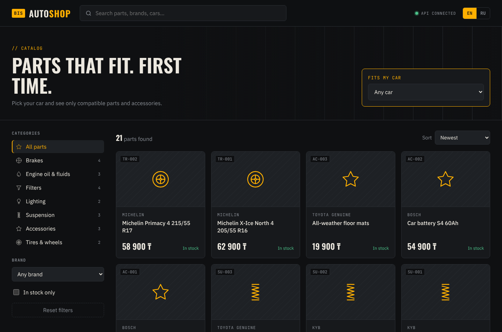
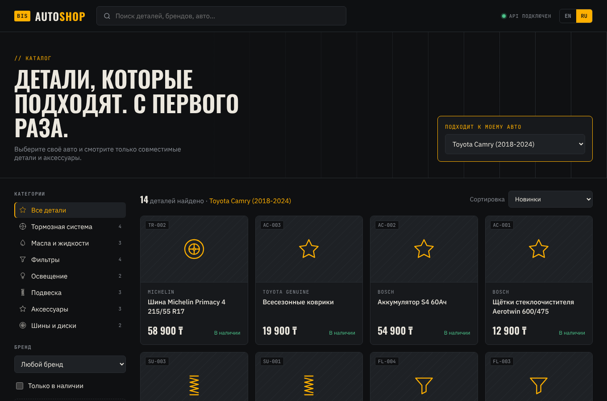
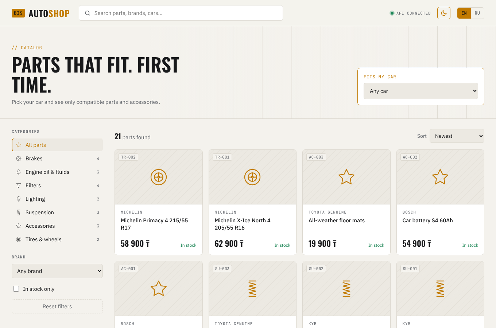
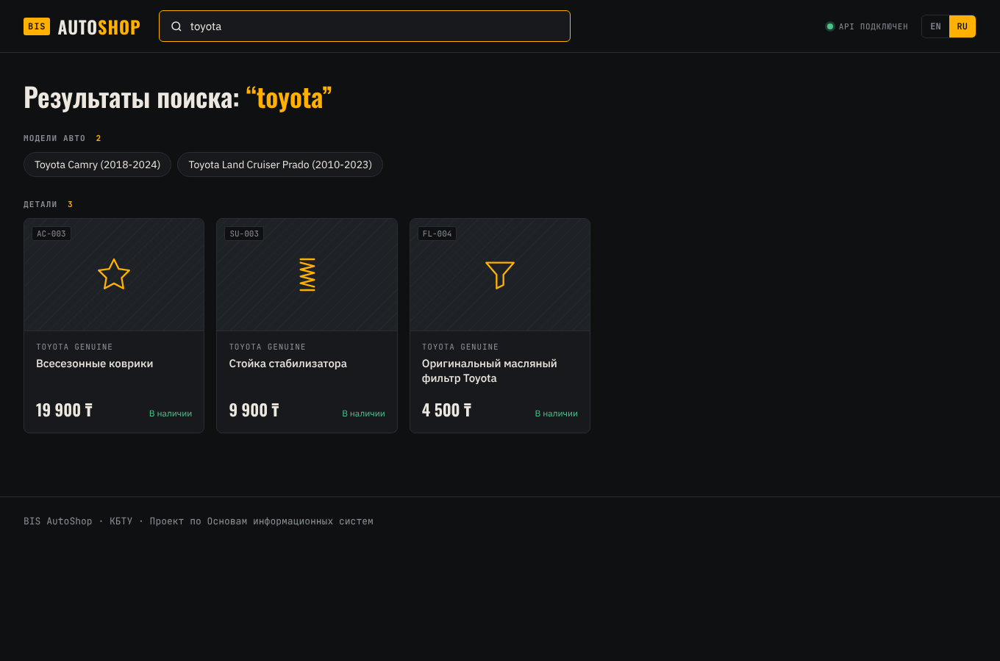

<div align="center">

# 🔧 BIS AutoShop

**Online shop for auto parts & accessories: product catalog, cart and order processing**

_Basics of Information Systems (INFT3107) · KBTU · Group project · Topic #11 "Online Shop"_


</div>



## Aim

Build a web store where a driver selects their car and, within 3 clicks, finds and orders a part that is guaranteed to fit it.

## The problem we solve

Buying car parts online is risky: the same "brake pads" come in dozens of sizes, and buyers often order a part that doesn't fit their car. **AutoShop links every product to compatible car models** ("Fits my car"), so the customer only sees parts that fit.

## Objectives

1. Catalog with categories, brands and filters, with a **"Fits my car"** compatibility filter
2. User registration and login with roles: **customer, manager, admin**
3. Cart and checkout that store orders in the database and reduce stock
4. Admin panel: CRUD for products, categories, cars and order status
5. Global search across 3 entity types (parts, categories, car models)
6. Full interface in **English and Russian**

## Features & progress

| # | Feature | Backend API | Frontend | Status |
|---|---|:-:|:-:|---|
| 1 | Product catalog + filters + sorting + pagination | ✅ | ✅ | Done (Week 10) |
| 2 | "Fits my car" compatibility filter | ✅ | ✅ | Done (Week 10) |
| 3 | Product details page | ✅ | ✅ | Done (Week 10) |
| 4 | Global search (products, categories, cars) | ✅ | ✅ | Done (Week 10) |
| 5 | Multilanguage EN / RU | — | ✅ | Done (Week 10) |
| 5a | Dark / light theme (remembered per browser) | — | ✅ | Done (Week 10) |
| 6 | Registration & login (JWT) | ✅ | ⏳ | Week 11 |
| 7 | Cart | ✅ | ⏳ | Week 11 |
| 8 | Checkout & order history | ✅ | ⏳ | Week 11 |
| 9 | Admin panel (CRUD, role-based access) | ✅ | ⏳ | Week 12 |
| 10 | User profile / "My garage" | ⚠️ partial | ⏳ | Week 13 |

## Team

| Member | Role | Responsibility | GitHub |
|---|---|---|---|
| **Lim** _(full name)_ | Application & Development | Backend (Django REST API), frontend (Angular), integration, GitHub | [@adjansxzd](https://github.com/adjansxzd) |
| _Name_ | _Role_ | _e.g. Business analysis, SWOT, competitors_ | `@username` |
| _Name_ | _Role_ | _e.g. Database design, ER diagram_ | `@username` |
| _Name_ | _Role_ | _e.g. UI/UX, testing, presentation_ | `@username` |

## Architecture

```
┌──────────────────────┐    HTTP / JSON    ┌───────────────────────┐   Django ORM   ┌──────────┐
│  Angular 20 (SPA)    │ ───────────────▶ │  Django REST API      │ ─────────────▶ │  SQLite  │
│  localhost:4200      │ ◀─────────────── │  localhost:8000/api   │ ◀───────────── │  db file │
│  ApiService (HTTP)   │   JWT in header   │  CORS · JWT · Swagger │                └──────────┘
└──────────────────────┘                   └───────────────────────┘
```

**How data moves (example, "Fits my car")**: the user picks *Toyota Camry* → Angular calls `GET /api/products/?car=1` → Django filters `Product ⋈ product_compatible_cars` → returns JSON → Angular renders the product cards.

### Data model (main tables)

`User (role)` · `Category` · `Brand` · `CarModel` · `Product` · `Product ↔ CarModel` (compatibility, M:N) · `Cart` · `CartItem` · `Order` · `OrderItem`

## Project structure

```
bis-autoshop/
├── backend/                 Django project
│   ├── config/              settings, root URLs
│   ├── accounts/            custom User with roles, register/login/me
│   ├── catalog/             products, categories, brands, car models, search, seed command
│   └── orders/              cart, checkout, orders + API tests
├── frontend/                Angular app
│   └── src/app/
│       ├── core/            ApiService (all HTTP calls), models, i18n + theme services
│       ├── components/      header, product card
│       ├── pages/           catalog, product detail, search
│       └── shared/          pipes (translate, price), icons
└── docs/                    API reference, AI usage log, screenshots
```

## How to run

**Requirements:** Python 3.10+, Node.js 20+

### Windows (quick)
1. Double-click `setup_backend.bat` (first time only: installs packages, creates the DB, adds demo data)
2. Double-click `start_backend.bat` → API at http://127.0.0.1:8000/api/
3. Double-click `start_frontend.bat` → site at http://localhost:4200

### Manual (any OS)
```bash
# backend
cd backend
python -m venv .venv
.venv\Scripts\activate          # macOS/Linux: source .venv/bin/activate
pip install -r requirements.txt
python manage.py migrate
python manage.py seed           # demo data: 21 parts, 8 car models, 3 demo users
python manage.py runserver

# frontend (new terminal)
cd frontend
npm install
npm start
```

| URL | What |
|---|---|
| http://localhost:4200 | Website |
| http://127.0.0.1:8000/api/docs/ | Swagger: all API endpoints, try them live |
| http://127.0.0.1:8000/admin/ | Django admin |

`python manage.py seed` creates **local demo accounts** (`admin`, `manager`, `customer`, password printed in the console). They exist only in your local database; never use them on a deployed server.

## API

Full list: [docs/API.md](docs/API.md) · live Swagger at `/api/docs/`

```
GET  /api/products/?car=1&category=brakes     catalog with filters
GET  /api/search/?q=toyota                    search in products + categories + cars
POST /api/auth/register/  ·  /api/auth/login/ JWT auth
POST /api/cart/items/  ·  /api/orders/checkout/
```

## Testing

```bash
cd backend
python manage.py test
```
10 automated API tests cover: health check, public catalog, filters ("Fits my car"), 3-entity search, registration, **role access** (a customer can't create products, a manager can), **cart → order** flow with stock reduction, and error cases (more than stock, empty cart checkout).

## Screenshots

| Russian UI + "Fits my car" | Light theme | Search |
|---|---|---|
|  |  |  |

## AI usage

We used AI as a coding assistant. What it generated, what we changed and how we tested it is logged in [docs/AI_USAGE.md](docs/AI_USAGE.md).
